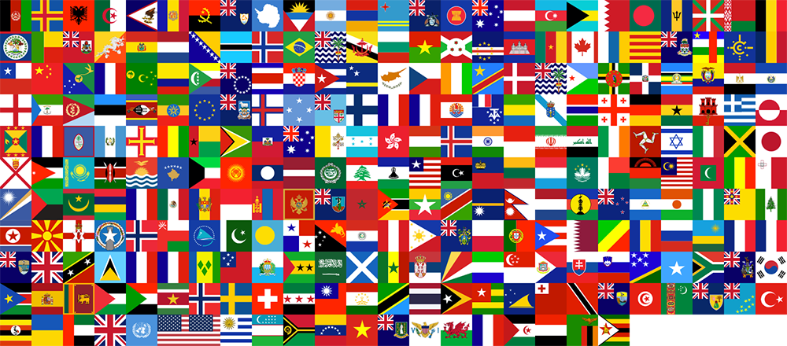
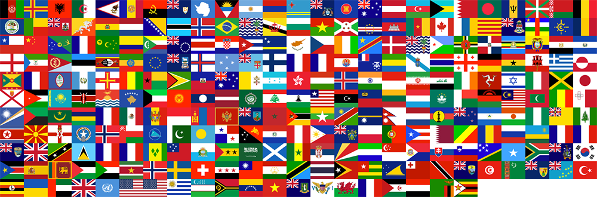

# Comentsys.Assets.Flags

**Comentsys.Assets.Flags** is an **Asset Resource** in **.NET Standard** for **Flags** for all **Countries** in the **World** available from [github.com/lipis/flag-icons](https://github.com/lipis/flag-icons) originally curated by [github.com/koppi](https://github.com/koppi) and uses **Comentsys.Toolkit**.

## Change Log

### Version 2.0.0

- Add Flag Metadata and Update for New / Fixed Flags

### Version 1.1.0

- Update for Comentsys.Toolkit

### Version 1.0.0

- Initial Release

## Flag

`Flag` represents **Flags** of the **World** from **Jakob Flierl** and **Lipis**

### Examples

#### Square



#### Rectangle



### Get(set, type)

Get Asset Resource

| Name | Description |
| ---- | ----------- |
| `set` | `Comentsys.Assets.Flags.FlagSet`<br>Flag Set |
| `type` | `Comentsys.Assets.Flags.FlagType`<br>Flag Type |

#### Returns

Asset Resource

### GetColors(type)

Get Asset Colors

| Name | Description |
| ---- | ----------- |
| `type` | `Comentsys.Assets.Flags.FlagType`<br>Flag Type |

#### Returns

Array of `System.Drawing.Color`

## FlagSet

`FlagSet` represents the **Set** of the **Flag** to use from either **Rectangle** or **Square**.

### Rectangle

Rectangle Flag - 4x3

### Square

Square Flag - 1x1

## FlagType

`FlagType` supports **271** different **Flags** as well as `None`. 

```
None
Afghanistan
AlandIslands
Albania
Algeria
AmericanSamoa
Andorra
Angola
Anguilla
Antarctica
AntiguaAndBarbuda
Argentina
Armenia
Aruba
AscensionIsland
AssociationOfSoutheastAsianNations
Australia
Austria
Azerbaijan
Bahamas
Bahrain
Bangladesh
Barbados
BasqueCountry
Belarus
Belgium
Belize
Benin
Bermuda
Bhutan
Bolivia
BonaireSintEustatiusAndSaba
BosniaAndHerzegovina
Botswana
BouvetIsland
Brazil
BritishIndianOceanTerritory
BruneiDarussalam
Bulgaria
BurkinaFaso
Burundi
CaboVerde
Cambodia
Cameroon
Canada
CanaryIslands
Catalonia
CaymanIslands
CentralAfricanRepublic
CentralEuropeanFreeTradeAgreement
Chad
Chile
China
ChristmasIsland
ClippertonIsland
CocosKeelingIslands
Colombia
Comoros
CookIslands
CostaRica
Croatia
Cuba
Curacao
Cyprus
CzechRepublic
CotedIvoire
DemocraticRepublicOfTheCongo
Denmark
DiegoGarcia
Djibouti
Dominica
DominicanRepublic
EastAfricanCommunity
Ecuador
Egypt
ElSalvador
England
EquatorialGuinea
Eritrea
Estonia
Eswatini
Ethiopia
Europe
FalklandIslands
FaroeIslands
FederatedStatesOfMicronesia
Fiji
Finland
France
FrenchGuiana
FrenchPolynesia
FrenchSouthernTerritories
Gabon
Galicia
Gambia
Georgia
Germany
Ghana
Gibraltar
Greece
Greenland
Grenada
Guadeloupe
Guam
Guatemala
Guernsey
Guinea
GuineaBissau
Guyana
Haiti
HeardIslandAndMcDonaldIslands
HolySee
Honduras
HongKong
Hungary
Iceland
India
Indonesia
Iran
Iraq
Ireland
IsleOfMan
Israel
Italy
Jamaica
Japan
Jersey
Jordan
Kazakhstan
Kenya
Kiribati
Kosovo
Kuwait
Kyrgyzstan
Laos
Latvia
LeagueOfArabStates
Lebanon
Lesotho
Liberia
Libya
Liechtenstein
Lithuania
Luxembourg
Macau
Madagascar
Malawi
Malaysia
Maldives
Mali
Malta
MarshallIslands
Martinique
Mauritania
Mauritius
Mayotte
Mexico
Moldova
Monaco
Mongolia
Montenegro
Montserrat
Morocco
Mozambique
Myanmar
Namibia
Nauru
Nepal
Netherlands
NewCaledonia
NewZealand
Nicaragua
Niger
Nigeria
Niue
NorfolkIsland
NorthKorea
NorthMacedonia
NorthernIreland
NorthernMarianaIslands
Norway
Oman
PacificCommunity
Pakistan
Palau
Panama
PapuaNewGuinea
Paraguay
Peru
Philippines
Pitcairn
Poland
Portugal
PuertoRico
Qatar
RepublicOfTheCongo
Romania
Russia
Rwanda
Reunion
SaintBarthelemy
SaintHelena
SaintHelenaAscensionAndTristanDaCunha
SaintKittsAndNevis
SaintLucia
SaintMartin
SaintPierreAndMiquelon
SaintVincentAndTheGrenadines
Samoa
SanMarino
SaoTomeAndPrincipe
SaudiArabia
Scotland
Senegal
Serbia
Seychelles
SierraLeone
Singapore
SintMaarten
Slovakia
Slovenia
SolomonIslands
Somalia
SouthAfrica
SouthGeorgiaAndTheSouthSandwichIslands
SouthKorea
SouthSudan
Spain
SriLanka
StateOfPalestine
Sudan
Suriname
SvalbardAndJanMayen
Sweden
Switzerland
Syria
Taiwan
Tajikistan
Tanzania
Thailand
TimorLeste
Togo
Tokelau
Tonga
TrinidadAndTobago
TristanDaCunha
Tunisia
Turkmenistan
TurksAndCaicosIslands
Tuvalu
Turkiye
Uganda
Ukraine
UnitedArabEmirates
UnitedKingdom
UnitedNations
UnitedStatesMinorOutlyingIslands
UnitedStatesOfAmerica
Uruguay
Uzbekistan
Vanuatu
Venezuela
Vietnam
VirginIslandsBritish
VirginIslandsUS
Wales
WallisAndFutuna
WesternSahara
Yemen
Zambia
Zimbabwe
```

## Licence

```
The MIT License (MIT)

Copyright (c) 2013 Panayiotis Lipiridis

Permission is hereby granted, free of charge, to any person obtaining a copy of
this software and associated documentation files (the "Software"), to deal in
the Software without restriction, including without limitation the rights to
use, copy, modify, merge, publish, distribute, sublicense, and/or sell copies
of the Software, and to permit persons to whom the Software is furnished to do
so, subject to the following conditions:

The above copyright notice and this permission notice shall be included in all
copies or substantial portions of the Software.

THE SOFTWARE IS PROVIDED "AS IS", WITHOUT WARRANTY OF ANY KIND, EXPRESS OR
IMPLIED, INCLUDING BUT NOT LIMITED TO THE WARRANTIES OF MERCHANTABILITY,
FITNESS FOR A PARTICULAR PURPOSE AND NONINFRINGEMENT. IN NO EVENT SHALL THE
AUTHORS OR COPYRIGHT HOLDERS BE LIABLE FOR ANY CLAIM, DAMAGES OR OTHER
LIABILITY, WHETHER IN AN ACTION OF CONTRACT, TORT OR OTHERWISE, ARISING FROM,
OUT OF OR IN CONNECTION WITH THE SOFTWARE OR THE USE OR OTHER DEALINGS IN THE
SOFTWARE.
```